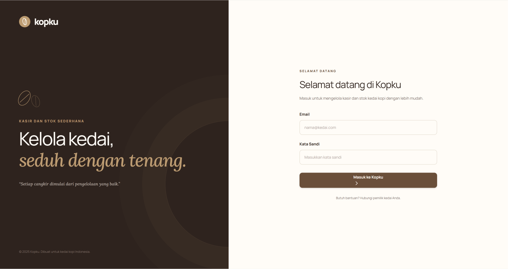
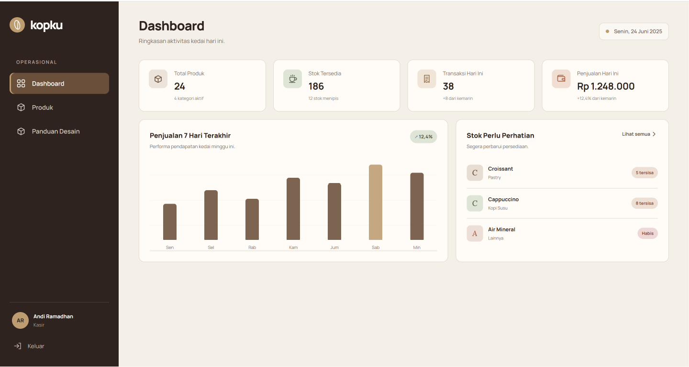

<div align="center">

# ☕ Kopku
### Aplikasi Kasir dan Stok Sederhana untuk Kedai Kopi


**Digitalisasi pencatatan penjualan dan stok untuk membantu operasional kedai kopi kecil.**

[Proposal](docs/proposal.md) · [Wireframe](docs/wireframe.md) · [Panduan Git](docs/collaboration.md)

</div>

---

## 👤 Project Information

- **Project:** Kopku
- **Course:** Pemrograman Berbasis Web (PBW)
- Repositori tautan: tajuddinachmad/Kopku
- **Author/team:**
  1. Tajuddin Achmad - (A11.2025.16548)
  2. Keyla Azzahra Mefia - (A11.2025.16533)
  3. Cantik Indah Lestari - (A11.2025.16139)


## 🧾 Overview
Kopku adalah rancangan aplikasi web kasir dan pengelolaan stok sederhana untuk kedai kopi kecil. Aplikasi direncanakan untuk membantu pencatatan transaksi, pengelolaan produk, pemantauan stok, dan penyajian ringkasan penjualan.

**Status Milestone 1:** fokus pada dokumentasi kebutuhan, rancangan antarmuka yang sudah tersedia, struktur awal repository, dan kolaborasi Git. Fitur yang tercantum di bawah ini masih merupakan rencana, bukan klaim bahwa implementasinya sudah selesai.

## Latar Belakang
Pencatatan penjualan dan stok secara manual berisiko menyebabkan data sulit ditelusuri, perbedaan stok catatan dan stok aktual, serta kesalahan penghitungan pendapatan. Pemilik kedai juga dapat mengalami kesulitan memantau penjualan ketika tidak berada di lokasi.

## 🎯 Project Goals

- Merancang aplikasi web sederhana untuk kebutuhan kasir dan stok kedai kopi.
- Menentukan masalah, target pengguna, dan kebutuhan fitur utama.
- Mendokumentasikan wireframe yang sudah dibuat oleh kelompok.
- Menyiapkan struktur repository dan dokumentasi awal.
- Mengerjakan proyek secara bertahap sesuai milestone mata kuliah PBW.

## 👥 Target Users

| Pengguna | Kebutuhan yang direncanakan |
|---|---|
| **Admin/Kasir** | Mengelola produk, kategori, stok, pencatatan penjualan, dan riwayat transaksi sesuai hak akses. |
| **Pemilik usaha** | Memantau ringkasan penjualan dan stok dengan akses baca sesuai rancangan. |


## ✨ Planned Features

### 📦 Product & Inventory

- Rencana pengelolaan kategori produk.
- Rencana pencatatan nama produk, harga, dan jumlah stok.
- Pencarian atau filter produk.
- Indikator stok menipis sebagai fitur yang direncanakan.

### 🛒 Sales Transaction

- Rencana pencatatan transaksi penjualan.
- Rencana detail transaksi berupa produk, jumlah, harga satuan, dan subtotal.
- Perencanaan pengurangan stok setelah transaksi berhasil disimpan.

### 📊 Dashboard & Reports

- Ringkasan jumlah produk dan stok.
- Ringkasan transaksi dan penjualan harian.
- Riwayat transaksi atau laporan sederhana sesuai ruang lingkup pengembangan berikutnya.

### 🔐 Access & Usability

- Rencana login, logout, dan session.
- Rencana form tambah/edit dan konfirmasi penghapusan data.
- Rencana pencarian/filter dan pagination dengan jQuery AJAX.
- Tampilan tanggal dan waktu serta validasi formulir.


## 🧰 Planned Tech Stack

Teknologi yang direncanakan mengikuti panduan PjBL Pemrograman Berbasis Web.

| Teknologi | Rencana penggunaan |
|---|---|
| HTML5 | Struktur halaman |
| CSS3 | Tata letak dan responsivitas UI/UX |
| JavaScript | Interaksi dasar serta tanggal/waktu |
| PHP Native | Logika aplikasi, form, session, dan CRUD |
| MySQL / MariaDB | Penyimpanan data |
| jQuery + AJAX | Pagination atau pemuatan daftar data tanpa reload penuh |
| Git + GitHub | Version control dan kolaborasi |
| Web hosting | Publikasi pada tahap akhir |


## 🖼️ Initial Wireframes

**Tautan Figma:** [Lihat Desain Kopku]([https://www.figma.com/make/WRgAqIMfwf1VYrMWDuww2E/Redesign-Kopku-POS-Interface?fullscreen=1&t=i5cfjRPlhNYbTuTP-1&code-node-id=0-6](https://www.figma.com/design/yffhptu8cIXB6LpsbnXrpI/Untitled?node-id=0-1&t=aJvQSZUODX8jOq0V-1))

Wireframe awal perlu mencakup atau dapat dipetakan ke empat halaman inti Milestone 1:

1. **Login** — formulir username/email dan password.
2. **Dashboard** — ringkasan informasi utama kedai.
3. **Daftar Produk** — daftar produk, harga, stok, dan pencarian/filter bila dirancang.
4. **Form Produk** — form tambah atau edit produk.

Lihat [`docs/wireframe.md`](docs/wireframe.md) untuk pemetaan kebutuhan ke desain yang sudah tersedia.


## 🗂️ Project Structure

```text
Kopku/
├── assets/
│   └── images/
│       └── wireframes/       
├── css/
├── docs/
│   ├── proposal.md
│   ├── wireframe.md
│   └── collaboration.md
├── js/
├── index.html
├── .gitignore
└── README.md
```

## 🚀 Getting Started

### Current milestone

Untuk meninjau proyek:

1. Buka `README.md` untuk ringkasan proyek.
2. Baca [`docs/proposal.md`](docs/proposal.md) untuk latar belakang, tujuan, pengguna, dan ruang lingkup.
3. Baca [`docs/wireframe.md`](docs/wireframe.md) untuk referensi desain Figma yang sudah ada.
4. Baca [`docs/collaboration.md`](docs/collaboration.md) untuk panduan kolaborasi Git.

Untuk mengunduh repository:

```bash
git clone https://github.com/tajuddinachmad/Kopku.git
cd Kopku
```


## 📝 Planned Git Commits

Contoh urutan commit untuk perubahan yang benar-benar dilakukan:

```text
docs: improve Kopku project README
docs: add project proposal and user requirements
docs: document existing wireframes and collaboration workflow
```

Commit harus dibuat secara bertahap. Jangan menggunakan pesan tersebut sebelum perubahan terkait benar-benar ada pada repository.


## 📚 Documentation

- [Project Proposal](docs/proposal.md) — latar belakang, rumusan masalah, tujuan, pengguna, dan ruang lingkup.
- [Wireframe Reference](docs/wireframe.md) — pemetaan kebutuhan ke desain Figma yang sudah ada.
- [Collaboration Guide](docs/collaboration.md) — usulan alur kerja branch, commit, dan pull request.

---

### Preview Wireframe

**Login**



**Dashboard**



---

## Pengembangan Opsional

1. **Peringatan stok menipis:** menjawab masalah barang habis saat ramai.
2. **Cetak struk sederhana:** memberi bukti pembayaran untuk pelanggan.

---


## Log Penggunaan AI

| **Tanggal** | **Tujuan** | **Perintah / Prompt** | **Bagian Solusi yang Dibantu** | **Penjelasan Konsep & Penyesuaian Mandiri** | **Hasil Pengujian** |
|---|---|---|---|---|---|
| 13 Oktober 2026 | **Perencanaan struktur repositori dan README** | "Bagaimana struktur direktori GitHub yang rapi untuk proyek aplikasi kasir berbasis web serta bagaimana menyusun README.md untuk dokumentasi awal proyek?" | Rekomendasi struktur folder dan kerangka dokumentasi proyek. | Menyesuaikan struktur dokumentasi dengan kebutuhan Kopku POS dan mempertahankan tautan desain Figma yang sudah tersedia. | Struktur awal repositori dan dokumentasi proyek disiapkan untuk mendukung kolaborasi tim. |
| 13 Oktober 2026 | **Identifikasi kebutuhan aplikasi kasir** | "Apa saja fitur utama yang dibutuhkan dalam aplikasi Point of Sale untuk kedai kopi dengan pengguna admin/kasir dan pemilik?" | Identifikasi fitur login, dashboard, manajemen produk, kategori, stok, dan transaksi. | Memilih fitur sesuai kebutuhan operasional kedai kopi serta membatasi ruang lingkup pengembangan berdasarkan target proyek. | Daftar fitur awal berhasil disusun sebagai acuan perencanaan. |
| 14 Oktober 2026 | **Perencanaan kolaborasi Git dan GitHub** | "Bagaimana mengatur alur kerja Git dan GitHub untuk proyek web kelompok yang dikerjakan oleh tiga anggota?" | Panduan pembagian tugas, sinkronisasi perubahan, commit, dan push. | Menyesuaikan alur kerja dengan repositori kelompok dan membahas pentingnya melakukan sinkronisasi sebelum mengirim perubahan. | Alur kolaborasi awal dapat dijadikan pedoman kerja tim. |
| 14 Oktober 2026 | **Dokumentasi target pengguna** | "Bantu susun deskripsi target pengguna aplikasi kasir kedai kopi beserta kebutuhan masing-masing pengguna." | Penyusunan deskripsi pengguna admin/kasir dan pemilik. | Menentukan hak akses berdasarkan kebutuhan operasional kasir dan kebutuhan pemilik untuk memantau informasi usaha. | Target pengguna dan kebutuhan awal masing-masing peran terdokumentasi. |
| 15 Oktober 2026 | **Dokumentasi rancangan antarmuka** | "Bagaimana menyusun dokumentasi wireframe aplikasi kasir berdasarkan desain Figma yang sudah dibuat?" | Panduan dokumentasi halaman login, dashboard, daftar produk, dan formulir produk. | Menggunakan desain Figma Kopku yang sudah tersedia tanpa membuat ulang desain, lalu menjadikan dokumentasi sebagai acuan pengembangan berikutnya. | Dokumentasi rancangan antarmuka awal disiapkan untuk mendukung tahap implementasi. |
| 16 Oktober 2026 | **Penyusunan struktur dokumentasi proyek** | "Bagaimana membagi dokumentasi proyek web ke dalam beberapa file Markdown agar lebih terstruktur dan mudah dipahami?" | Rekomendasi pemisahan proposal, dokumentasi wireframe, dan panduan kolaborasi. | Menyesuaikan isi setiap dokumen dengan kebutuhan Milestone 1 serta menghindari dokumentasi teknis yang belum diperlukan pada tahap ini. | Struktur dokumentasi lebih terorganisasi dan mudah ditinjau anggota kelompok. |
| 17 Oktober 2026 | **Penyusunan README GitHub** | "Bantu susun README.md untuk Kopku POS yang berisi deskripsi proyek, tujuan, fitur, teknologi, struktur folder, dan informasi tim." | Penyusunan bagian utama README.md. | Memeriksa kembali nama proyek, anggota kelompok, tautan repositori, tautan Figma, dan fitur yang direncanakan. | Draf README tersedia sebagai dokumentasi utama repositori. |
| 18 Oktober 2026 | **Menampilkan gambar pada README** | "Bagaimana cara menambahkan gambar wireframe dari folder repositori ke dalam README.md menggunakan Markdown?" | Contoh sintaks Markdown untuk menampilkan gambar dan menggunakan path relatif. | Menyesuaikan path gambar dengan lokasi aset di repositori serta memastikan nama file yang digunakan sesuai dengan file sebenarnya. | Sintaks penampilan gambar dapat diperiksa melalui tampilan README di GitHub. |
| 19 Oktober 2026 | **Pemeriksaan kelengkapan Milestone 1** | "Bantu buat checklist untuk memeriksa kelengkapan perencanaan proyek aplikasi kasir sebelum melanjutkan ke tahap implementasi." | Checklist dokumentasi, target pengguna, fitur, rancangan antarmuka, repositori, dan riwayat commit. | Menggunakan checklist untuk mengidentifikasi bagian yang sudah tersedia dan bagian yang masih perlu dilengkapi oleh kelompok. | Kelengkapan awal proyek dapat ditinjau sebelum masuk ke tahap selanjutnya. |

**Catatan:** AI digunakan sebagai alat bantu dalam perencanaan dan dokumentasi. Hasil yang diberikan tetap ditinjau dan disesuaikan oleh anggota kelompok. Kolom hasil pengujian perlu diperbarui berdasarkan kondisi repositori dan hasil pemeriksaan yang benar-benar dilakukan.
<p align="center">
  <strong>Kopku</strong><br>
  <sub>Brew better workflows. Track every product. Build incrementally.</sub>
</p>
